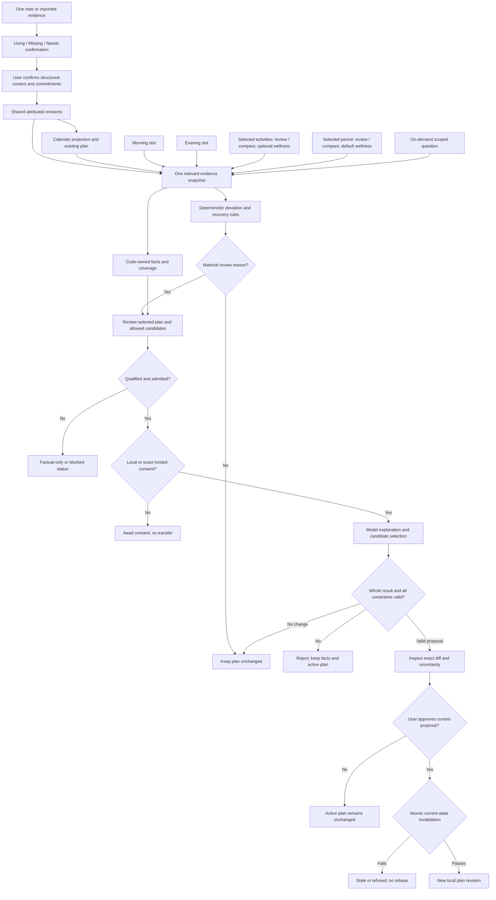
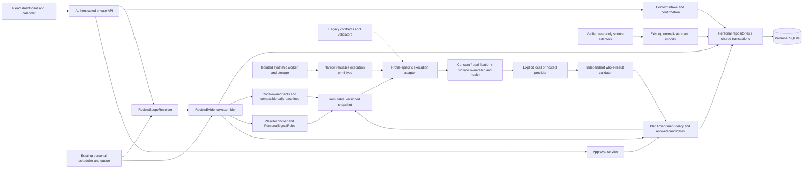
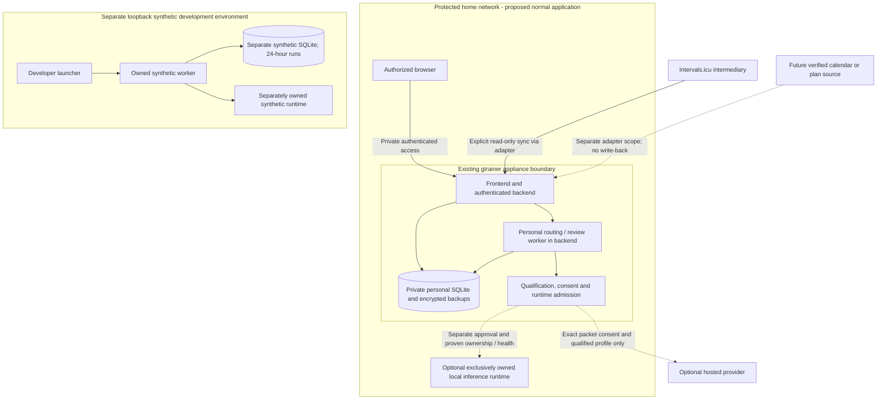

# Design

## Context

See [proposal.md](proposal.md) for motivation and the delta specs for behavior. This is a **proposed target architecture**, not implemented, qualified or deployed behavior. User-confirmed direction includes all reporting scopes, two daily automatic reviews and adaptation of an **existing** plan. Initial plan generation is deferred.

### Current implementation and concrete gaps

| Area | Observed implementation | Consequence for this change |
| --- | --- | --- |
| Historical ranges | `Trends.kt:10–17,110–123`: 1–366 inclusive dates; always preceding equal-duration comparison | Reuse arithmetic, not calendar comparison semantics |
| Scheduled ranges | `ReviewScheduleModels.kt:28–35`: day/week/activity/rolling up to 90 dates | Add explicit versioned scopes, preserve old decoding |
| Duplicate date logic | `ReviewScheduler.kt:56–68` and `ReviewQueueService.kt:34–53` | Extract one pure resolver before adding scopes |
| Session evidence | `HealthRecords.kt:21–38`, `IntervalsNormalizer.kt:88–95` retain duration, distance, average HR and load; `AnalysisInput` uses period aggregates | Expose existing session facts first; no invented streams or interval analysis |
| Wellness arithmetic | `Trends.kt:170–178,224–230`: per-record means, source-local dates and incomplete upstream coverage | Preserve legacy facts; prepare separate compatible per-day baseline input |
| Context | `AthleteContext.kt:82–103`: as-of retrieval, latest revisions and expired exclusion | Add interval-aware new-profile applicability and unresolved/review-due states |
| Claim scope | `InterpretationContractV1.kt:175–218`: observed context date must fall inside claim window; checks cited restrictions | New profiles must distinguish attribution dates from applicability and check all constraints |
| Calendar | `ManualEvents.kt:11–20,72–77`: date-only user events, UTC ordering, no model use | Add explicit associations/projections; an event is not a base plan |
| Personal queue | `ReviewQueueService.kt:34–55,88–129`: executes legacy focus profile; `status():60–64` can reconcile/invalidate | Add a profile adapter; keep new inspection inert and move reconciliation to explicit lifecycle/tick paths |
| Connected execution | Existing snapshots, consent, validators and executor; no ordinary scope-to-snapshot creation endpoint | Add one evidence assembly entry point, not a parallel runner per review purpose |
| Frontend evidence | `ConnectedReviewPanel.tsx:84–86` reads `id`; `SummaryFact` supplies `evidenceId` | Correct inspection mapping with a real-wire-shape regression |
| Source integration | `HistorySource` exposes activities/wellness only | External calendar/plan reads and detailed streams are not assumed available |
| Development | Separate synthetic database, owned worker, extended policy and 24-hour event-driven retention | Never repoint that store/launcher at personal evidence |

The pending `athlete-context` main-spec synchronization belongs to `connected-insights-context`. Implement against its existing interfaces, but synchronize its deltas before this follow-on. Its two incomplete qualification tasks and frozen evidence remain untouched. No qualification transfers to new profiles.

## Goals / Non-Goals

**Goals:**
- One scope resolver, one inert evidence assembler and one shared context source, used by manual, morning/evening and adaptation review entry points.
- Facts, reconciliation, threshold evaluation, allowed operations and plan application owned by code; models supply bounded interpretation and non-executable explanation.
- Phased delivery that is useful without external calendar integration or enabled inference.

**Non-Goals:**
- A generic rules language, autonomous coach, initial-plan generator, rehabilitation progression, screenshot/OCR pipeline, chat-memory engine or complete activity-stream importer.
- A new service, broker, vector database, replacement scheduler or blanket `HistoryStore` rewrite.
- Changing legacy contracts, development ownership/cleanup/TTL behavior, deployed resource policy or existing provider consent.

## Decisions

### 1. One phased change; protect historical contracts

Deliver in order: **scope/evidence foundation → single-entry context and authored plan → scheduled reviews → deterministic adaptation → approved local amendments → new-profile qualification**. Foundation and deterministic UI tests use synthetic data/fake providers. Inference and live operational acceptance are separately authorized later.

Keep `factual-review-v1`, `review-focus-app-v1`, `connected-review-v1` and their frozen packets, prompts, validators, qualification fixtures/captures and ledger unchanged as historical profile evidence. This does not require retaining their HTTP routes or old prototype model/analysis interfaces as permanent runtime compatibility. Introduce separately versioned scoped descriptive, context-intake suggestion and plan-amendment profiles. Do not remove V1 prescription rejection to make planning fit. A shared execution engine accepts explicit profile-specific assembly/validation adapters where still consumed by guarded execution; no provider fallback or budget inheritance from development.

The canonical factual preparation API is `GET /api/reviews/options` and `POST /api/reviews/prepare`. The POST carries explicit mode, intent, scope, wellness policy and factual focus; its response carries prepared facts, charts and provenance. Trends and Reviews reuse one frontend form and evidence card. Overview retains factual numeric tiles and date controls, using the same client/parser and server-resolved dates rather than another reporting protocol; tile navigation opens the detailed reporting surface. Do not add a separate prototype panel or provider selection to factual preparation: it never invokes inference. Retire `/api/trends`, `/api/analysis-input`, `/api/review-facts`, `/api/scoped-trends/v1`, old prototype `/api/models` and `/api/analysis`, and orphan manual `/api/review-interpretation`; retain `/api/review-now` and existing qualified, guarded execution. No aliases or compatibility adapters.

Alternative: expanding the 20/22-complete change would contradict its manual-only/descriptive intent and blur qualification. Separate follow-on artifacts avoid that. Separate micro-changes for every scope would duplicate shared foundations; one phased change is simpler.

### 2. Resolve scope once; keep temporal meanings explicit

Introduce a pure `ReviewScopeResolver` returning requested scope, activity identities, resolved evidence dates, full calendar boundaries, comparison dates/policy, saved schedule timezone, source date basis and captured `asOf` instant. Keep baseline windows and future plan horizon in separate fields, not in `TrendRange`.

Keep **selection target**, **review/compare intent**, and **wellness usage** separate, rather than interpreting activity IDs as a date-range request. Both modes share the resolver/evidence pipeline and profile-specific instructions, not separate workers:

| Mode | Target and intent | Wellness default |
| --- | --- | --- |
| Selected activities | Exactly the selected verified IDs; review one or several sessions, or compare at least two selected sessions | Optional; off initially. User may display associated wellness only, or explicitly include it in assessment |
| Selected period | Records in the resolved historical period; review the period, or compare it against resolved comparison dates | Available relevant wellness included automatically, with dates/coverage and an inspectable inclusion choice |

Selected-session comparison has no implicit previous activity or previous bounding interval. A one-activity selection is reviewable but requires another explicit selection to compare sessions. Same-sport and mixed-sport/triathlon selections are valid; preserve each session's identity/sport and compare only compatible metric bases. Equal units alone do not make sport-specific effort or training effects interchangeable, and selection does not establish a linked triathlon event. Activity-set requests allow at most **1,000 unique verified IDs within 366 inclusive source dates**; reject unknown/duplicate IDs and over-limit requests without truncation. Existing request byte/record limits still apply.

Wellness **display**, **assessment evidence**, and **comparison subject** have distinct meanings, without requiring three independent UI switches. An optional activity-context control can offer off/display-only/include-in-assessment. Display-only measurements do not enter provider packets; including context in assessment does not automatically compare those measurements between sessions. Activity comparisons default to activity metrics. Period comparisons may include compatible wellness metrics by default, with explicit inclusion/omission disclosure. Mandatory applicable restrictions are not optional wellness and remain required under every mode.

| Selection | Resolution / default comparison |
| --- | --- |
| Activity or selected activities | Stable imported identities; exact sessions only, session timestamps separate; compare selected sessions only when requested, with no fabricated prior-activity comparison |
| Day/night | Selected source date; night assigned only under verified source semantics; previous day where compatible |
| Calendar week | Monday–Sunday; current period through local date; matching elapsed portion of previous week |
| Calendar month/year | Actual calendar boundaries, including leap dates; current period marked so far |
| Last 7/30/365 days | Anchor minus N−1 dates through anchor; preceding N dates |
| Custom historical | 1–366 inclusive dates; preceding equal-length default or explicitly selected comparison |

Day, verified night, calendar, rolling and custom period selections may override their default with any explicit historical **1–366-date** comparison range. It may overlap or follow the selected period while remaining historical at the captured cutoff. Disclose actual dates, overlap and unequal duration; never label such a comparison an independent or like-for-like default. This explicit period relationship is distinct from comparison among selected session IDs.

For unequal calendar periods, default comparison uses the same elapsed ordinal-date count capped to both periods' lengths. Preserve full selected totals and separately report unmatched dates; completed calendar periods expose previous-calendar totals with unequal-duration disclosure rather than pretending they are equal. No silent normalization into a per-day value. Default comparisons are optional when insufficient evidence exists.

Historical activity grouping retains source-local start dates; wellness retains source dates. Saved timezone governs schedule occurrences and current-period anchoring, not a silent rebucketing of imported records. Explicitly show this distinction near travel/midnight boundaries. Morning uses latest available wellness (possibly dated yesterday), today's existing plan and applicable constraints; evening is the selected day **so far at its cutoff**, not a promise that every import has arrived.

A directly selected activity with a verified start instant at or before the cutoff may retain a source-local date ahead of the saved schedule date; disclose the mismatch rather than moving its date. A future source-local date without a verified past instant requires clarification. Do not silently broaden historical period ranges to include it, and preserve legacy arrival-routing behavior.

Alternative: UI-only presets over `range.previous()` cannot represent calendar semantics. Rewriting legacy Trends would alter frozen evidence; new comparison preparation can reuse its metric arithmetic with explicit ranges.

### 3. Build one inert, versioned evidence snapshot

`ReviewEvidenceAssembler` reads authorized local records only. It does not sync, infer or mutate context. Capture relevant data/revisions consistently in a short repository read boundary, assemble immutable serialized evidence outside long-held locks, then create the snapshot transactionally only if bindings are still current; otherwise rebuild without a provider call.

Evidence selection follows the mode/intent and explicit wellness policy, not every available category. Selected activities exclude intervening activities and intervening wellness dates. Optional activity wellness associates verified preceding sleep and day observations with each selected session; a source date alone proves neither a preceding-night association nor that a measurement was available before the activity. Disclose observation/receive dates and any timing uncertainty. Shared daily wellness may be shown beside several sessions but retains one evidence identity and is not counted repeatedly. Longer baseline context remains a separately labeled window, not selected activity evidence.

Training readiness is an optional attributed vendor observation only when a verified adapter actually supplies it. Show sleep and HRV separately when available, without claiming knowledge of the readiness formula, assuming they exhaust its inputs, or computing a substitute score. Current normalized imports do not establish readiness availability or preceding-night mapping; expose unsupported/unverified status instead of fabricating either. Association requires verified source semantics, not a user-picked date guessed by the model.

The new evidence envelope contains:
- Resolved scope/selection mode, review/compare intent and explicit comparison relationship, purpose (`morning`, `evening`, `activity_reflection`, `period_reflection`, `question`, `adaptation`), optional question and attributed additional text.
- Code-prepared period facts/comparisons and bounded session facts: source IDs/timestamps, sport, moving/elapsed seconds, metres, kcal, average HR and Intervals load where present.
- Compatible daily wellness selected for assessment/comparison under the mode policy, explicit baseline facts and data-quality/coverage status. Display-only optional wellness stays in the authenticated inspection view, outside provider packets.
- Context identities/revisions, mandatory restrictions, needs-review items and confirmed commitment occurrences.
- Selected base-plan/session revision, reconciled findings, rule-policy revision and deterministic reasons.
- Evidence cutoff, omitted optional-detail counts, provider/model/profile and exact packet digest.

Bind the intent, wellness-assessment choice, compared metric subjects and verified association provenance into the snapshot. Changing model-visible inclusion invalidates the packet/consent binding; refreshing display-only context neither authorizes transfer nor initiates inference. New descriptive instructions explicitly distinguish session-to-session comparison from period comparison and contextual wellness from compared values. Neither mode may explain performance as caused by sleep, HRV or a readiness score alone.

Use a capability matrix: `available`, `unverified`, `unsupported`, `not_configured`; absence is not proof of no commitment or no workout. No new live-source call is needed for planning. Investigate candidate external APIs through public documentation and synthetic schemas only; do not implement an adapter whose fields/auth scope are unproven. Initially use local authored plans and confirmed commitments. A substantial external integration becomes a separate change.

Retain 50,000-record input bounds and normal 32 KiB prompt/12 KiB response limits. Annual snapshots use deterministic period/sport/daily aggregates and bounded representative/session detail with authenticated drill-down. Mandatory constraints never compete with optional detail. Overflow fails closed; no automatic window reduction, silent truncation, resource increase or model swap.

Alternative: sending raw provider JSON/screenshots creates larger, less attributable inputs. Bounded normalized evidence provides the same available measurements with explicit gaps.

### 4. Single-entry context, not duplicated memory

Reuse attributed context identity/revision/deletion storage. Add a small intake identity with original text and source; proposed item revisions link to it. A user may save a note without extracting anything. Optional qualified extraction produces **suggestions only**, behind the same privacy/admission boundary; the UI supports explicit association without inference. Confirm each extracted item or a visible batch; resolving a relative date/recurrence is required before a calendar projection is committed.

Canonical structured items reuse existing context where appropriate; typed commitment/availability records own time/recurrence/exception fields and link to the intake/context identity. Calendar entries are projections, not copied prose. Do not automatically ingest legacy event notes; explicit association preserves existing event IDs and local event semantics.

The initial confirmation UI uses the no-inference manual fallback: save original
wording once, select an excerpt or explicitly choose the whole note, and stage
typed context/calendar items. Observation dates are explicit; relative weekdays
are not parsed or guessed. Drafts remain browser-local and inert until one item
or an inspectable selected batch is explicitly confirmed. The same context field
editor serves legacy direct edits and intake drafts. Optional qualified extraction
remains separately closed under tasks 5.1/5.3, not simulated as an implemented model.

`POST /api/context-intakes/{id}/confirm` confirms 1–20 selected items under the
aggregate 32 KiB UTF-8 limit and one owner transaction. It checks the intake and
existing item revisions, preserves identities, inherits source attribution and
records exact source links. Existing context corrections require the current
matching intake link; explicit association is separate from silent adoption.
A calendar item can explicitly reference a context item in the same batch by
index, binding the resulting confirmed revision rather than guessing an identity.
Required confirmation UUIDs have content-free ID/revision/hash receipts: replay
returns the original revisions without duplicate items or repeated invalidation.
Reusing a UUID for different content conflicts. Receipt insertion and all item,
link, lifecycle and invalidation writes are atomic. Deletion must purge dependent
receipts as well as old source/item revisions; a receipt is not hidden health memory.
Uncertain transport/5xx/malformed-success outcomes block UI retry pending inspection.

Confirmed recurrence scope for task 2.4: local one-off, daily and weekly
commitments/availability with an explicit timezone, repeat interval/end date, and
per-occurrence cancel or reschedule exceptions. Expand only a requested horizon
of 1–366 inclusive dates. Broader calendar recurrence (monthly/yearly/positional
rules) is explicitly unsupported, not guessed or coerced. External calendar
adapters remain a separate change; this bounded recurrence choice does not
authorize external source reads or calendar writes.

Individual commitment/availability intervals support multi-day spans up to
366 local wall-clock days, independently of the 1–366-date projection horizon.
Intervals have explicit local endpoints and timezone; resolved instants are
half-open. Daily/weekly recurrence preserves the local endpoints/day offset.
Use the existing schedule timezone policy (gap shifted forward, earlier overlap
offset), disclose adjustments, and require clarification if resolved endpoints
are not a positive interval. A recurrence end date limits original start dates;
reschedule exceptions retain their original occurrence identity, even when moved
into the horizon from outside it. Projection is fail-closed above 50,000 occurrences.

Confirmed source-edit policy: correcting intake wording appends a source revision;
it never silently rewrites confirmed items. Exact source-revision links remain
inspectable with a source-changed/needs-reconfirmation status, dependent reviews
are invalidated, and updating an item retains its context identity through explicit
reconfirmation. An intake association is user-asserted provenance, not independent
verification or authorization to transfer the original note.

Confirmed shared-source deletion policy: preview dependencies and require
user-approved replacement source wording when a deleted item's text occurs in a
shared note. Purge old source revisions and dependent sensitive output; explicitly
reconfirm surviving sibling links to the redacted source. Preserve unrelated
items rather than automatically deleting a whole shared group. Until the atomic
confirmation/redaction workflow is implemented, reject linked context correction
and deletion through old mutation routes rather than bypassing it. This staged
guard does not complete deletion task 2.6 or claim backup erasure.

Distinguish `observedOn`, applicability interval, `reviewDueOn`, unresolved/resolved state and revision. A symptom is a user report, not a medical restriction. A review due date signals a targeted update, not expiry or resolution. At the end of applicability, historical guidance is no longer asserted current; unresolved safety-relevant context remains needs-review and blocks **affected** amendments until clarified. An unresolved conflict blocks connected review as under the existing capability. No stale context is secretly retained after deletion for supposed safety.

Confirmed lifecycle policy: an explicit user resolution deactivates an item's
new-profile operational blocking, without asserting recovery or medical clearance.
Retirement alone does not resolve safety-relevant context: retired unresolved
symptoms/restrictions remain historical needs-review items for affected amendments.
Historical reviews interpret current canonical corrected revisions using original
observation/applicability dates; they do not reconstruct what was known then.
Expose that interpretation basis. Keep V1 retrieval/DTO bytes unchanged through
separate revision-linked lifecycle metadata and new-profile projections. Lifecycle
edits preserve exact intake provenance, even if that source has since changed;
resolution is not source reconfirmation. Content correction resets resolution to
unresolved; retirement preserves it. No historical database migration is implied.

New interval retrieval considers both historical review coverage and future affected session dates, preserving old observation dates in citations. Validate every relevant restriction/commitment against resulting plan operations, independent of citations. Preserve the existing blocked/allowed/conflicting-maximum rules; do not have the model silently pick the stricter value.

Alternative: copying text into calendar notes, prompts and plan rows recreates the user's duplication problem and deletion hazards. Shared identities plus projections keep correction authoritative.

### 5. Minimal existing-plan domain

Add `PlanRevision`, `PlannedSession` and `CommitmentOccurrence` through cohesive SQLite repositories. The current history schema class and single canonical history-schema JSON define current DDL; a fresh database is created atomically under `HistoryStore` transaction ownership. Plan/session IDs remain stable; edits create immutable revisions with origin/author and recorded-at metadata. Imported content is never independently verified coach guidance. Local entry is a first-class fallback, not an integration prerequisite.

A planned session records date/time precision, timezone, sport, objective, supported metric/range/basis and explicitly permitted amendments. Initial comparable metrics are moving/elapsed duration, distance, average HR, Intervals load and explicitly defined reported-effort scale **only where the plan and actual evidence share that basis**. Average HR is not interval intensity and load is not effort; unsupported prescription fields are retained as attributed text, not evaluated.

Users set the relevant future horizon up to 366 dates, import grace period and allowed move windows/duration bounds/omit permission. No omitted field grants permission. Date-only plans cannot be called skipped before the local date ends plus the grace period. Timed plans use their explicit scheduled end. Recurring commitments have saved timezone and exceptions; they remain separate from completed activity. A future horizon must not expand the historical record or prompt budget.

Initial operations are `move_session`, `reduce_duration`, `omit_session`. Every affected session must already exist and be future at approval. Moving cannot produce forbidden conflicts; duration reduction cannot fall below the explicitly allowed minimum; omission preserves audit history. No increased intensity/volume, new make-up workout, cross-sport substitution or rehabilitation progression. These are deliberately conservative proposals, **not a medical-safety guarantee**. Unsupported situations return no candidate/needs clarification.

Alternative: free-form plan rewriting is hard to validate and risks creating prescriptions without a basis. A small operation vocabulary permits mechanical review and later separately qualified expansion.

The local authored-plan implementation uses one immutable aggregate per plan
revision. Session UUIDs survive edits; new sessions receive new UUIDs, and manual
removal affects only the new revision, not history. It never infers identity by
position or similar prose. A separately persisted selection generation protects
selection/deselection and selected-plan edits against A→B→A races. Saving a new
plan never selects it. Editing an already selected plan advances its exact
reference and selection generation in the same transaction; editing another plan
does not select it. Coach attribution means entered by the user, not independently
verified coach authority.

Policy is optional; missing policy leaves adaptation timing unavailable. Explicit
policy supplies an IANA adaptation timezone, 1–366-date inclusive future horizon
and 0–31,622,400-second import grace. Operation permissions default to denied.
Move windows follow the session's date-only or local-time precision, use its
unchanged timezone and span at most 366 local days. Duration-result bounds require
a matching moving/elapsed target, positive whole seconds up to 2,678,400, and do
not change calendar occupancy. Omit permission is distinct from an already
authored omitted state. Future candidate/approval validation remains responsible
for restrictions, commitments, no increases and exact resulting intervals.

Timed plans require separate explicit start/end; moving duration cannot supply
wall-clock end. Unlike commitment projections, authored timed inputs refuse DST
gaps and require a valid explicit offset for overlaps; resolved offsets are saved
with the revision. Skipped civil dates are refused for date-only sessions. A
date-only amendment closes at the earlier start of that date in the session and
adaptation zones; a timed one closes at its scheduled start. Unmatched timing is
the next session-local date's start or explicit timed end plus configured grace,
never a confirmation of skipping. Browser/display timezone cannot reopen a cutoff.

Targets are closed metric/unit/basis combinations: seconds moving/elapsed,
metres session-total, beats/minute session-average, attributed Intervals.icu
session load and explicitly identified reported-effort scale points. Effort scale
definitions have immutable UUID identities; matching names or numeric ranges do
not establish compatibility. Unsupported prescription detail stays attributed
notes, not an evaluated target or operational permission. Technical ceilings are
100 plans, 1,000 revisions per plan, 1,000 sessions per revision, six targets per
session, 160-character titles and 4,000-character notes. The independent 32 KiB
aggregate mutation/canonical-definition byte bound can be reached first; no
truncation, silent splitting or implicit budget increase occurs.

Plan entry/edit/selection and read-only calendar inspection share the existing
Events & plans dashboard section. Unsaved draft overlays remain distinct from
authoritative selected-plan entries, confirmed commitments/availability and
imported recorded activity. Independent calendar reads do not claim an atomic
review snapshot or automatic matching. Dirty, pending and uncertain plan states
guard both click and keyboard section navigation; explicit logout clears private
state. Acknowledged mutations whose refresh fails remain blocked pending read-only
inspection, not retryable creation attempts. External adapter status and the
separate-change boundary are recorded in the
[source capability matrix](../../../docs/data/source-capability-matrix.md).

### 6. Deterministic findings and thresholds, not model routing

`PlanReconciler` prefers an explicit planned-session link, then compatible date/sport/time evidence under a documented matching policy; ties stay ambiguous. Users can confirm matches/skips. Unmatched planned sessions remain provisional after the configured grace period; absent or failed imports never establish skipped training. An unmatched recorded activity is extra **relative to this selected plan**, not automatically an unplanned mistake.

Confirmed matching policy (user choice, 2026-10-16): initial reconciliation is
one-to-one, not grouped recordings. Automatic candidates require exact sport and
a verified recording start in the authored half-open `[start,end)` interval, not
exact equality with the planned start. Date-only intervals use the session-zone
civil day. Only mutually unique edges match automatically; no nearest-start,
metric similarity, tolerance or iterative elimination is implied. Matching uses
the entire selected plan and complete bounded local activity support, independently
of the displayed range. Competing candidates require explicit confirmation.
Authenticated stable-identity links can resolve unverified timing without inventing
an instant. Links bind the whole normalized record, receive revision and exact plan
revision; changed evidence requires reconfirmation. A stale explicit link reserves
its activity until cleared/reconfirmed, rather than silently reallocating it.
Explicit skips require configured session-end-plus-grace and no compatible current
candidate; clearing a link does not reject the underlying recording. Inspecting or
confirming reconciliation does not change the authored plan or imply an amendment.

Confirmed import-removal policy (user choice, 2026-10-16): remove saved factual
review packets/outputs/previews and complete `(plan,session)` confirmation histories
that ever referenced a recording, across revisions and deselected plans. Removing
only current match heads could resurrect earlier skip assertions and is forbidden.
Skip/clear-only histories, original notes and authored plans survive. Publication
is revoked before cascading source deletion; unresolved content-free runtime
ownership/attempt/stop identities survive and continue to occupy the resource.
Removal never establishes physical termination or erases retained backups.

Planned-range checks use `authored_inclusive_range_v1`: exact authored endpoints are
inclusive, with no inferred tolerance, unit conversion or moving/elapsed substitution.
Metric-specific above/below findings do not classify whole-session effort or interval
intensity. Current matched evidence is required; unsupported prescription prose is
not parsed. Initial inspection exposes whitelisted facts through reconciliation,
without changing the independently versioned provider packets before task 7.4's
consistent snapshot/reason integration.

Reported effort is a separate typed, attributed activity ledger, not extracted
context. Reports bind an immutable scale definition, explicit observation date,
whole current record fingerprint and nullable import revision. Corrections require
explicit reaffirmation. A lineage has one current head; withdrawn heads never
reactivate an older report. Exact operation replay acknowledges the historical write
without appending, relinking or advancing reason revisions. Owner transactions fence
the report head, record, detachment generation and optional inspected-plan origin.
Withdrawal preserves the original value/date/attribution/evidence binding and remains
available without imported data; ordinary capacity reserves a final withdrawal.

Confirmed effort ownership (user choice, 2026-10-16): original reports survive import
removal as **detached, inactive history**. A durable detachment generation fences
old writes, including identical reimports. Reimport or historical receipt replay MUST
NOT reactivate testimony; only a new explicitly confirmed report revision can do so.
History can be inspected and withdrawn without a current recording. An uncertain
report write locks matching, plan edits and navigation until authoritative effort
history is explicitly inspected; recovery inspection itself remains available.

`PersonalSignalRules` operates on code-selected daily observations, not per-record Trends means. Bind intermediary, metric field, verified method and upstream origin where required; use one compatible sample per date under an explicit selection policy. If the source does not expose required identity/method, that rule remains unavailable. Baselines use a configured trailing 1–366-date window **excluding the evaluated date**, median of valid compatible values, configured minimum samples/coverage and freshness. Threshold types are explicit absolute deviation, percentage deviation or absolute limit with compatible units; zero-baseline percentage rules are unevaluable. No enabled HRV/sleep default or medical cutoff is supplied.

Each rule also binds direction, persistence count, reset boundary, cooldown and policy revision. Gaps/ambiguous/stale dates break consecutive-day persistence. Hysteresis requires a less severe reset boundary than the trigger boundary. Cooldowns suppress repeated unchanged alerts; a materially different finding or explicit policy change can create a new reason. Explain all selected baseline dates, configured thresholds and unevaluable reasons. Any subjective effort remains an attributed report using its declared scale.

Confirmed cooldown policy (user choice, 2026-10-16): a verified reset followed by a
new qualifying trigger inside cooldown waits until cooldown expiry, and only
current compatible measurements still satisfying trigger persistence can request
review then. Hysteresis-band, missing or stale data do not qualify a pending episode.
Expiry never repeats an already emitted continuous episode. Only successful reason
admission acknowledges emission and starts cooldown; pure evaluation does neither.

Task 7.3 supplies typed immutable configuration, pure daily evaluation/transitions,
read-only inspection and an internal owner-fenced state projection seam. Task 7.4
owns atomic reason admission/acknowledgement, correction-aware continuation and queue
coalescing; no public projection-commit endpoint or new worker is introduced. Until
that integration, inspection explicitly reports admission `not_integrated`, never
claims a reason was queued, and production runtime remains closed. A current-day
projection is replaceable from its captured pre-day state, not incremented again
on inspection. Unknown prior episode history cannot be assumed reset or unalerted;
without a validated checkpoint, verified reset establishes a new known anchor.
Changed imports or policy conservatively require reevaluation without forgetting
acknowledged episode facts. A connection write token fences capture-to-commit races,
not historical evidence validity. The initial internal seam uses the complete source
revision as a conservative continuation fence; task 7.4 must supply validated
correction/checkpoint dependencies before enabling an admission caller.

Extra activity is material only under a configured compatible workload rule or explicit user review request; do not run inference for every short imported record. Confirmed skips and supported range violations request adaptation review; unresolved injury/illness/availability changes request clarification or reevaluation, not a diagnosis. Findings can be detected without inference and can conclude **no change**.

Confirmed workload/repeat policy (user choice, 2026-10-16): support both per-record
and cumulative compatible-extra-work rules, with aggregation, metric, window and
threshold explicitly configured per rule. No metric, lookback or threshold is a
medical or implicit default. Already admitted planned-range/extra-work findings request another
review only after genuine clearing and retriggering, or an explicit user request;
changed-but-still-abnormal values alone do not re-admit. Corrections still fence
stale results independently of repeat admission. A signal policy edit preserves
existing cooldown and unknown-history safeguards; the user confirmed no edit-based
cooldown bypass.

Changed constraints remain distinct canonical change events as required above;
the clear/retrigger choice for abnormal workload/range readings does not suppress
reevaluation when an applicable restriction or commitment materially changes.

Initial constraint enrollment policy (user choice, 2026-10-16): **baseline only**.
The first complete enrollment capture establishes the existing canonical constraint
baseline without requesting an initial review; those constraints remain binding in
every subsequent review/proposal. Explicit review remains a distinct request. Later
relevant canonical changes request review, while unchanged horizon membership or
clock-derived lifecycle projections do not manufacture canonical change events.
Track complete bounded owner mutation ancestry, including cancellations/removals
and A→B→A changes between polls; absence from an eligibility projection is never
deletion proof. Compare old and new effects under the same current horizon.

Returning-plan policy (user choice, 2026-10-17): preserve the original family
baseline, chronology and admission receipts across deselection/reselection. Still
relevant material changes observed while deselected request one coalesced review
on return; unchanged constraints do not retrigger. Selection generation remains an
authorization/ABA fence, never a new enrollment or permission to erase history.

Coalesce reasons by selected base-plan revision, configured horizon, rule policy and relevant evidence revisions—not by display scope alone. A morning/evening review can reuse the current adaptation result. New evidence revises provisional findings and fences stale proposals; it does not cancel a healthy running review just because a sync arrived. Repeated imports and calendar/rolling views do not create independent duplicate findings.

Alternative: a model deciding what is abnormal produces opaque, non-reproducible thresholds. A general rules DSL is unnecessary; bounded typed configuration and pure rules cover the requested cases.

### 7. Reuse personal scheduling and bounded execution

Create two explicit daily-time slots with purpose, chosen local `HH:mm` and saved timezone; no guessed hour or timezone. Once enrolled/re-armed, they prepare briefs automatically. Reuse existing DST occurrence handling, durable routing/coalescing and 256-job capacity; ordinary personal results remain bounded by the existing outcome capacity. New review-input revisions include context, commitments and base-plan changes, not just imports.

Extract a profile-specific executor adapter into the existing personal queue rather than adding another scheduler. Reuse connected execution admission, immutable attempt binding, normal budgets (300 seconds/attempt, 600 total by default, at most one correction after validation failure), provider consent and inference serialization where safe. Ordinary policy ceilings remain unchanged. Exact time/byte/cost limits are reported from the chosen normal policy, never a synthetic development policy.

Local auto execution requires explicit saved selection plus separately approved qualification and authoritative personal runtime ownership/resource-health evidence. The production adapter remains unavailable until that boundary is implemented and accepted; socket closure is not stop proof. Share proven ownership/health interfaces only through explicit personal adapters, never the synthetic database, endpoint permission, extended budget or safety receipts from another runtime. No competing execution or live takeover.

Hosted slots prepare snapshots but await exact-packet consent; there is no blanket scheduled hosted authorization, fallback or escalation. Provider/model/packet change invalidates consent. Transfer permission, inference admission and plan approval are independent decisions.

Keep restart policy: prior claimed work is interrupted/fenced, selection/arming requires explicit restoration and old missed slots are not replayed. Show this prominently rather than promising unattended recovery. Schedule wake-ups route review work, not independent development retention sweeps. Development runs still expire 24 hours after creation with event-driven deletion and authoritative cancellation.

Confirmed automatic-preview retention policy (2026-10-16): when a scoped outcome
leaves the existing 24-entry queue history, its unexecuted automatically prepared
execution preview may expire with it. Original imported/context/plan data, manual
previews, executed reviews and unresolved runtime ownership remain protected.
Preview preference is an explicit optional slot provider/model selection, not
consent or inference authority. Factual snapshot plus queue completion remain one
atomic commit; optional exact-preview assembly follows outside owner locks, with
binding insertion and retained-outcome attachment in a second fenced transaction.
A crash between them leaves an explicit preview-not-prepared factual result; neither
restart nor inspection resumes preparation or inference. No new consent/run route
or accepted personal runtime is implied.

New-profile inspection is read-only. Extract current personal queue selection reconciliation from `status()` into explicit configuration/tick/worker paths while preserving publication fencing; polling must not start work or invalidate jobs as a side effect. Do not refactor unrelated application routes.

Alternative: reusing the development worker wholesale would cross personal/synthetic isolation and policy boundaries. Reusing narrow execution primitives and the personal routing queue preserves separation.

### 8. Generate allowed candidates; approve an exact proposal

Confirmed initial enumeration policy (user choice, 2026-10-17): **boundary-only
V1**, not exhaustive search or optimization. Move alternatives use the authored
earliest/latest start, deduplicated and excluding unchanged starts. Duration-result
alternatives clamp both authored endpoints at the permitted minimum or original
lower endpoint, yielding distinct permitted point ranges with at least one strict
decrease. No percentage, time grid or clinical reduction magnitude is invented.
Omission requires its separate explicit permission. Empty boundary results do not
prove that no permissible interior alternative exists. Above 100 candidates or a
shared work/byte limit, fail the whole set; never retain the first 100.

Confirmed timed-move policy (user choice, 2026-10-17): preserve both authored
wall-clock span and elapsed occupancy. If both cannot be preserved, request
clarification. Newly ambiguous destination offsets are not invented. Date-only
sessions retain whole-civil-day precision. Duration reductions do not shorten
calendar occupancy. Original and resulting sessions must remain future and wholly
inside the configured horizon; never clip a session before constraint validation.

Confirmed unsupported-constraint policy (user choice, 2026-10-17): block affected
candidates with needs-clarification rather than guess whether `allowed_*` is an
exclusive whitelist, what structured activity classification `*_activity` refers
to, what basis `maximum_duration` constrains, or whether availability is exhaustive
permission. Do not parse objectives/notes or infer medical applicability. Existing
explicit sport prohibitions, context conflicts/lifecycle, and confirmed busy
commitments remain enforceable. Omission removes training occupancy, not unresolved
safety/source/conflict evidence. Constraint evaluation uses complete destination
intervals and all applicable sources, independently of model citations.

`PlanAmendmentPolicy` produces a bounded set of mechanically admissible candidate operations from explicit plan permissions and current restrictions/commitments. Initial candidate generation is simple and deterministic, not an optimizer. A model may select candidate IDs, propose no change and explain cited evidence under a new contract. Code resolves IDs to exact operations and independently validates the whole result. Explanations are non-executable; keyword/citation checks alone do not establish usefulness or safety.

Confirmed explanation policy (user choice, 2026-10-17): the amendment profile uses
code-owned, bounded explanation choices with exact text, sources and uncertainty.
A draft may select these statements but may not rewrite numbers, units, dates,
attribution or add claims. This is amendment-only; scoped descriptive prose remains
unchanged. Choices describe authored operations, factual evidence availability and
uncertainty, not clinical suitability or inferred justification. Raw source prose
never becomes a trusted generated assertion. Exact matching is a conservative
mechanical check, not usefulness qualification or a clinical-safety guarantee.

Proposals bind exact base plan, affected sessions, before/after, evidence/context/commitment revisions, rules/policy, horizon and expiry. Initial expiry is the earlier of 24 hours after creation and the first affected session's start (start of local date if date-only); no past-session edits. Inference failure never becomes an applied plan. Unknown required applicability blocks the affected candidate; no inference of recovery or permission from silence.

Durable local proposal records retain compact checked operations, exact explanations
and revision/binding references, not raw drafts, full prompts or duplicated evidence
packets. Generation from a locally submitted draft is explicit and separate from
inference, approval and the inert validation endpoint. The original owner capture
must survive checking until the save transaction; a deserialized checked-result DTO
is never save authority. Exact-submission retries return the existing record without
renewing expiry or restoring pending state. The bounded repository admits at most
1,000 proposals without automatic eviction. Inspection is read-only and reports
effective stale/expired status separately from the stored outcome/disposition;
non-current inspection omits the sensitive projection.

The initial privacy policy is deliberately conservative: correction or deletion of
an existing context, intake or confirmed commitment purges all local proposal
projections and their submission hashes in the same owner transaction. Complete
constraint bindings can include records absent from snapshot dependency rows, so
snapshot cascades alone are insufficient. New constraint identities invalidate
freshness without pretending that they appeared in the original evidence. Imported
evidence removal cascades through snapshots into proposal/state rows. Context
deletion previews disclose all affected proposal identities and fingerprint proposal
creation/rejection so that deletion approval cannot silently cover a changed set.
This policy may remove unrelated pending proposals; users regenerate from current
evidence rather than recover hidden copies. It does not delete authored plans.

An authenticated approval carries proposal ID, expected plan revision and proposal digest/idempotency key. In one short transaction: check expiry, current relevant revisions, permissions, all restrictions and commitments; then append the new local plan revision and approval record. Concurrent approval/context/plan updates are serialized at this boundary. Reject stale approvals instead of silently rebasing. Repeated accepted approval returns its prior revision. No upstream write endpoint is introduced.

Proposal correction/deletion removes dependent sensitive explanation as under context deletion; the applied authored plan remains independently owned and is marked for reevaluation if its basis changes. Minimal content-free audit IDs do not retain deleted context. Review feedback remains user data, not measurements or model training.

The approval receipt has two layers. An immutable content-free audit retains only
operation/proposal identifiers, the applied local plan revision and timestamp. An
independently cascaded binding holds the approval-request hash while the proposal
survives. Deleting a proposal removes its submission/projection/request hashes and
all explanations; the audit prevents reuse of an already consumed operation ID
without recreating source or approval authority. A matching retry with a surviving
binding returns its original revision, even after subsequent edits or expiry. A
retry after proposal deletion is not-found; a consumed operation ID used for a
different proposal conflicts. Deletion previews disclose retained audit IDs. The
initial audit ceiling is 1,000 without eviction; reaching it refuses new approvals
rather than forgetting prior operation IDs. Applied inspection is terminal,
metadata-only and independent of the now-obsolete base source binding.

Alternative: letting model prose mutate the calendar bypasses versioning and approval. Exact diffs and code-owned application keep side effects explicit.

### 9. Qualification evaluates the real user journey

Freeze a new synthetic longitudinal protocol per new profile before any separately approved inference. Retain sparse V1 fixtures as robustness baselines, not proof of usefulness. Cases cover one-session review, same-sport/mixed-sport selected-session comparison, optional display-only versus assessed wellness, unknown prior-night/readiness semantics, default period wellness, overlapping explicit comparisons, morning missing sleep, evening delayed import, older applicable ACL-related context, stale improving illness, fixed/recurring commitments, conflicting restrictions, source/method ambiguity, extra workload, changed plans, deletion and stale approval.

Require useful complete finals, every case/dimension at least 2/4, weighted mean at least 80%, zero critical failures and independent human scoring. Freeze dimensions/weights/case count and exact artifacts before runs; any revision receives a new evaluation version. Count all rejections, timeouts, corrections, empty results and unrun cases. Context extraction also tests faithful suggestions and confirmation; adaptation tests unsupported operations, omitted restrictions, misleading explanations and no-change usefulness. Model self-review, candidate selection and JSON passes never open production gates.

## Mermaid diagrams

All four diagrams depict the **proposed** flow. Solid arrows show an allowed interaction once its prerequisite exists; deployment dashed arrows show separately gated/optional inference. No diagram grants deployment, source credentials or inference permission.

### Sequence: scheduled review, proposal and approval

```mermaid
sequenceDiagram
    actor User
    participant UI as Private dashboard
    participant Sources as Read-only source adapter
    participant Store as Personal SQLite repositories
    participant Scheduler as Existing personal scheduler
    participant Builder as Scope and evidence assembler
    participant Rules as Reconciliation and rules
    participant Executor as Profile execution adapter
    participant Model as Explicit selected provider
    participant Policy as Amendment policy

    User->>UI: Enter context once and select authored plan
    UI->>User: Show proposed structured items and ambiguities
    User->>UI: Confirm items and configure daily slots
    UI->>Store: Save canonical revisions and shared links
    Note over Sources,Store: Source sync is separately initiated; review does not fetch
    Sources->>Store: Validated activity and wellness revisions
    Scheduler->>Store: Commit morning/evening occurrence intent
    Scheduler->>Builder: Prepare eligible scoped review
    Builder->>Store: Read consistent relevant records and revisions
    Store-->>Builder: Evidence, context, commitments and base plan
    Builder->>Rules: Evaluate matches and configured signal rules
    Rules-->>Builder: Findings, reasons and unevaluable signals
    opt Adaptation purpose with explicit plan permissions
        Builder->>Policy: Enumerate admissible existing-session candidates
        Policy-->>Builder: Candidate IDs or no candidate / clarification
    end
    Builder->>Store: Bind immutable snapshot
    alt Mandatory conflict or overflow
        Builder-->>UI: Block affected review; keep facts visible
    else Usable bounded snapshot
        Executor->>Store: Check qualification, runtime and current binding
        alt Admission unavailable
            Executor-->>UI: Factual status; no model call
        else Hosted packet lacks consent
            Executor-->>UI: Exact preview awaiting user consent
        else Explicit execution is admitted
            Executor->>Model: Send bound profile-specific packet
            Model-->>Executor: Untrusted draft
            Executor->>Policy: Validate whole draft and every constraint
            Policy-->>UI: Review plus valid proposal, no change or rejection
        end
    end
    opt User chooses an approvable local amendment
        User->>UI: Approve exact before/after proposal
        UI->>Policy: Proposal ID, digest and expected plan revision
        Policy->>Store: Atomically recheck expiry, revisions and constraints
        alt Still current and permitted
            Store-->>UI: New local plan revision and approval receipt
        else Stale, conflicting or expired
            Store-->>UI: Refuse changes; request fresh review
        end
    end
```

### Interaction: user journey and decision boundaries



### Component: cohesive reusable boundaries



The policy is used both **before inference** to enumerate allowed candidates and **after inference/at approval** to validate resulting operations. The synthetic worker shares narrow primitives, not personal repositories or permission. Legacy profile adapters keep their own validators.

### Deployment: private appliance and optional inference boundaries



Deployment topology is illustrative: no new host, pod, port, service or memory allocation is selected. A local runtime on another host requires the same verified ownership/resource boundary, not generic access to a shared Ollama server. There is no public dashboard ingress, direct Garmin connection or development-to-personal data link.

## Refactoring and simplification plan

| Finding | Narrow change | Verification / avoid |
| --- | --- | --- |
| Duplicated scope/date resolution | Extract pure resolver; personal manual/scheduled paths consume it | Calendar/leap/DST/partial comparisons; preserve old profile serialization |
| Different packet preparation paths | One inert evidence assembler and profile adapters | Same input binding for equivalent manual/scheduled scope; no hidden fetch/call |
| Context copied into different views | Identity-linked projections plus shared interval applicability | Confirm/correct/delete once; no hidden stale safety memory |
| Growing mixed `HistoryStore` responsibilities | Add cohesive context/plan/evidence repository helpers and named SQL under shared transaction ownership | Atomic revisions/approval/deletion; no ORM or full rewrite for method length |
| Restriction shapes/applicability repeated | Share pure validated policy helpers at new-profile boundaries | Check all restrictions, not only cited ones; V1 replay bytes unchanged |
| Personal inspection reconciles selection | Separate inert status reads from explicit lifecycle/tick reconciliation | GET has no writes/cancellation/submission; stale publication still fenced |
| UI `id` versus `evidenceId` mismatch | Correct real contract mapping; centralize touched scope/unit DTOs | Backend-shaped fixture, displayed citations; avoid blanket frontend conversion |
| Duplicate digests and source identity encoding | Reuse a small byte-hash/source-tuple helper only where identical | Golden exact hashes; no recanonicalization of frozen contracts |
| Similar but isolated workers | Share only narrow proven executor interfaces | No synthetic data/policy/TTL leak or worker unification |
| Per-purpose and per-window products | Treat selection, review/compare intent, wellness policy, purpose, level and trigger as distinct inputs | Session comparison is not period comparison; no morning-by-every-scope preset explosion or rules DSL |

## Risks / Trade-offs

- **Imported fields cannot replace every screenshot** → disclose unsupported detail; reuse normalized duration/distance/HR first, do not infer absent streams.
- **Source baseline identity is insufficient** → rule stays unavailable until compatible semantics are verified; no averaging away origin uncertainty.
- **Two daily reviews become repetitive** → factual unchanged status, stable reason identity and shared adaptation results; questions are optional, not a quota.
- **Bounds are conservative and may produce no candidate** → explain no change/clarification; broaden operation scope only through separate design and qualification.
- **An apparently valid explanation still gives unsafe advice** → independent semantic evaluation, whole-draft rejection and non-executable prose; mechanical checks are not clinical safety proof.
- **Context expires or is deleted** → needs-review versus historical distinction, affected-proposal invalidation and complete deletion propagation.
- **Automatic morning data may be stale** → no new source-sync promise; show cutoff/coverage and do not infer a skipped session from absence.
- **Restart requires explicit re-arming** → retain fail-closed behavior and expose status rather than silently changing unattended recovery policy.
- **Deployment could inherit unverified runtime assumptions** → closed admission until separately accepted ownership/stop/resource controls and explicit operational approval.

## Fresh schema and restore validation

1. The current `HistoryStore` schema class and single canonical history-schema JSON are the current DDL source. No migration table, `ALTER` sequence or backfill chain is planned. An empty database is created atomically under `HistoryStore` transaction ownership; validate the current schema marker, seed state and `user_version=1` / `application_id=0x47544E52` (`GTNR`). A partial database with an old or incorrect marker is refused with a fixed reset message; never auto-delete or migrate it. This is not a promise to preserve old database bytes through migration.
2. Future extensions can add logical history records within revisions of the current schema; they do not imply a historical migration chain. Preserve current identities and existing context semantics without inferring resolution. Legacy event notes require explicit association. Existing schedule configuration remains disabled for new profiles; no guessed times, selected model or hosted consent.
3. Include the read-only restore validator/tooling code and tests in the implementation, including validation against the current schema manifest and refusal of legacy shapes. Do not perform an actual backup restore, decrypt/install a stable helper, alter or delete a database, or update live restore state.
4. Preserve development worker-store isolation and its current schema identity, with existing TTL/cancellation behavior unchanged; do not introduce a history schema-version chain there. Production personal inference stays disabled throughout implementation and offline evaluation.
5. Any live deployment or operational database action requires separate explicit approval. No artifact task authorizes publication or deployment.

## Configuration and deferred work

Implementation does not need personal values now: timezone, morning/evening times, plan horizon, import grace period, permitted amendments and signal policies are explicitly configured at enrollment; missing configuration is unavailable/disabled. No medical thresholds are embedded as defaults.

Deferred to separate changes: verified external calendar/plan adapters, first-plan generation from long-term goals, wider amendment operations, persistent autonomous execution after restart and blanket hosted scheduling consent. This change uses a local authored base plan and explicit re-arming, so those questions do not block its implementation.

### Reporting-convention references

The agreed semantics are product decisions, not replicas of proprietary formulas. Familiar activity/calendar/rolling separation is documented in [Polar reports](https://support.polar.com/e_manuals/verity-sense/polar-verity-sense-user-manual-english/polar-flow-web-service.htm), [Strava progress](https://support.strava.com/en-us/articles/15401618-progress-summary-chart), [Garmin HRV](https://www.garmin.com/en-US/blog/fitness/understanding-the-hrv-status-on-your-garmin-smartwatch/) and [Intervals progress](https://www.intervals.icu/features/track/). Vendor scores/baselines remain attributed, not equated with gtrainer's reporting windows or threshold policies.
